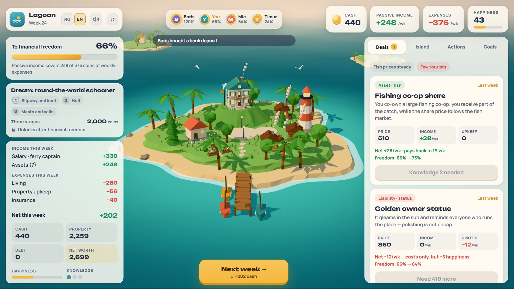
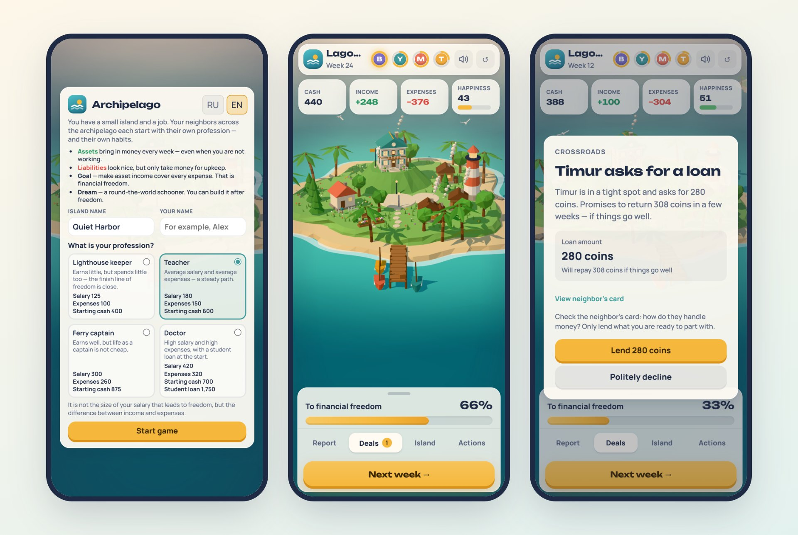
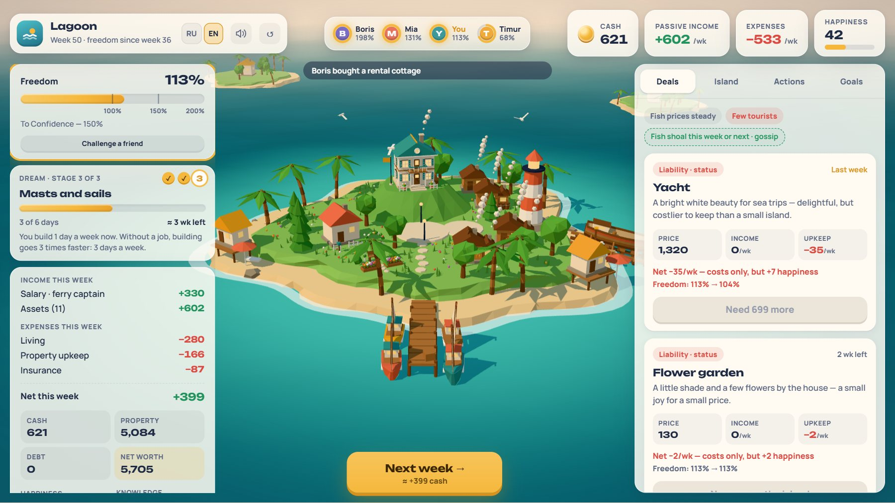

<div align="center">


# Archipelago

**A cozy browser game about money and financial freedom**

[](https://imdmtrv.github.io/archipelago/en/)
[](https://imdmtrv.github.io/archipelago/)

[](https://github.com/imdmtrv/archipelago/actions/workflows/ci.yml)
[](https://github.com/imdmtrv/archipelago/actions/workflows/deploy.yml)

**English** · [Русский](README.ru.md)

</div>

<p align="center"></p>

You have a small island and a job. Every week brings a paycheck and the bills. Buy things that pay you every
week — a fishing boat, a smokehouse, a rental cottage — and one day that income covers every expense. That's
financial freedom: you no longer need the job.

Free, no sign-up, no ads. Works on phones and desktops, in English and Russian.

## Why it exists

The game turns a simple idea into something you live through on your own island: **it isn't the size of your
salary that sets you free, but the gap between income and expenses — and what you do with it.** The board game
Cashflow teaches the same idea, but its dice move the outcome more than your decisions. In Archipelago, chance
creates situations and your choices decide how they end.

<p align="center"></p>

## What's inside

- **Four professions** with different starts — lighthouse keeper, teacher, ferry captain, or a doctor with a
  student loan. A big salary doesn't guarantee an early finish.
- **Assets vs. liabilities.** Boats, smokehouses, cottages, bungalows and a beach café pay every week and can be
  upgraded. A yacht or a golden statue of yourself looks great and only costs upkeep.
- **Neighbors with their own lives.** Mia, Timur and Boris ask for loans (and don't always pay back), sell things
  cheap when in trouble, and pass on rumors — reliable sources come true more often.
- **Risks and protection.** Storms, illness, layoffs and market swings in fish and tourism; insurance and a cash
  buffer soften them.
- **Three pyramid schemes** of different subtlety — from an obvious "+25% a week" pearl farm to a plausible
  mutual-aid fund.
- **Life after freedom.** Build your dream — a round-the-world schooner — stage by stage on the slipway.
- **Challenge a friend.** A link starts the same island for them, and your result sails along as a neighbor.

<p align="center"></p>

## How to play

1. Pick a profession and name your island.
2. Each week, check the deals: an asset shows its income and payback time, a liability shows only its cost.
3. Keep a buffer, decide on insurance, and answer your neighbors.
4. Press **Next week**. When passive income covers 100% of expenses, you're free.

## Under the hood

| | |
|---|---|
| Rules engine | Pure TypeScript, `(state, action) → state`, all randomness from a seed — the same seed and choices replay the same game (used for friend challenges) |
| Balance | A bot simulator plays thousands of games with different strategies; every rule change has to keep its targets green (`npm run sim`) |
| 3D | React Three Fiber / three.js, low-poly island with weather, water and a tilt-shift look; a still image replaces it where WebGL is unavailable |
| UI | React + Zustand, separate phone and desktop layouts, RU/EN dictionaries |
| Sound | Web Audio: recorded and synthesized effects and music, each switchable |
| Delivery | Vite build, GitHub Actions → GitHub Pages; [GoatCounter](https://www.goatcounter.com/) analytics without cookies or personal data |

```
packages/engine   game rules: deterministic TypeScript, no UI or network; tests and the balance simulator
apps/web          the game: React, React Three Fiber, interface, sound, translations
scripts/          checks (i18n, first minutes, sound), trailer and README screenshots
docs/             design documents, roadmap and acceptance reports (in Russian)
```

## Run locally

Requires Node.js 22.

```bash
npm install
npm run dev        # the game at http://localhost:5173
npm test           # engine unit tests
npm run sim        # balance simulation: thousands of bot games
npm run typecheck
npm run build
```

Extra pages in dev mode: `/?sandbox` — 3D scene showcase, `/?sound` — every sound with a recorded/synthesized
switch. Screenshots for this README are regenerated with `npm run readme:shots` (needs a build, `vite preview`
on port 4173 and Playwright).

## Feedback

Found a bug or have an idea? [Open an issue](https://github.com/imdmtrv/archipelago/issues) — or use the
feedback link that appears in the game after week 10.

## Credits

Sounds and music are CC0 / CC-BY works by their authors — see [CREDITS.md](CREDITS.md) (also linked in the game's
sound settings). Fonts: Manrope and Unbounded (SIL Open Font License).

## License

[PolyForm Noncommercial 1.0.0](LICENSE.md). Read, learn from, change and share the code for any noncommercial
purpose: personal projects, study, schools and other noncommercial organizations. Commercial use is reserved to the
author. The name "Archipelago" and the logo are not licensed for branding other products. Sounds and music are
third-party works under their own licenses — see [CREDITS.md](CREDITS.md).
