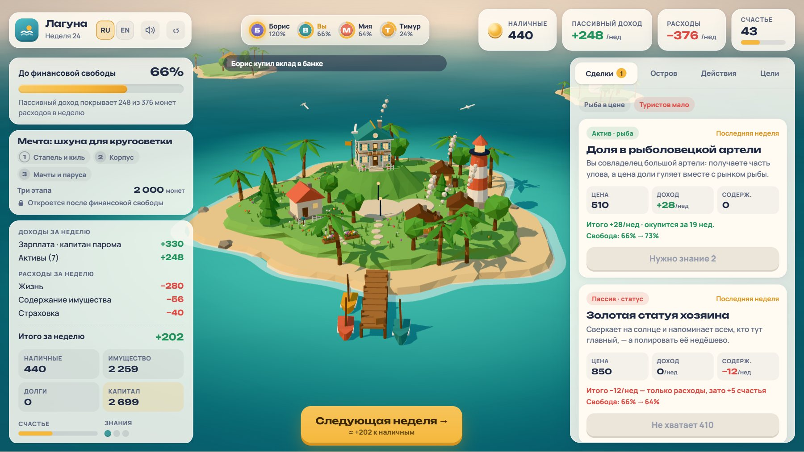
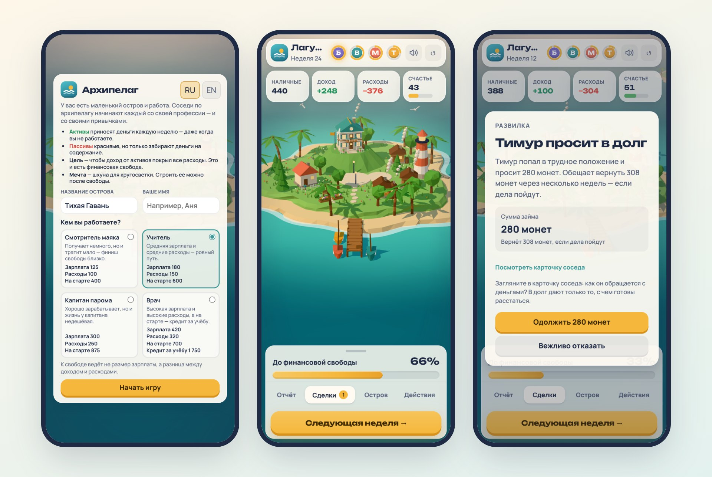
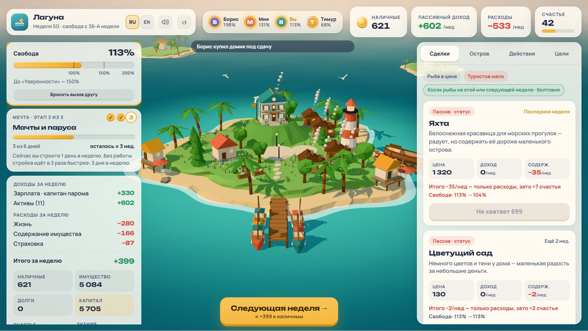

<div align="center">


# Архипелаг

**Уютная игра про деньги и свободу**

[](https://imdmtrv.github.io/archipelago/)
[](https://imdmtrv.github.io/archipelago/en/)

[](https://github.com/imdmtrv/archipelago/actions/workflows/ci.yml)
[](https://github.com/imdmtrv/archipelago/actions/workflows/deploy.yml)

[English](README.md) · **Русский**

</div>

<p align="center"></p>

У вас маленький остров и работа. Каждую неделю — зарплата и расходы. Покупайте то, что приносит деньги каждую
неделю, — рыбацкую лодку, коптильню, домик под сдачу, — и однажды этот доход покроет все расходы. Это и есть
финансовая свобода: работа больше не нужна.

Бесплатно, без регистрации и рекламы. Работает на телефоне и компьютере, по-русски и по-английски.

## Зачем эта игра

Игра превращает простую мысль в то, что проживаешь на своём острове: **к свободе ведёт не размер зарплаты,
а разница между доходом и расходами — и то, на что она уходит.** Об этом же настольная Cashflow, но в ней кубики
сдвигают исход сильнее решений. В «Архипелаге» случайность создаёт ситуации, а чем они кончатся — решает выбор.

<p align="center"></p>

## Что внутри

- **Четыре профессии** с разным стартом — смотритель маяка, учитель, капитан парома и врач с кредитом за учёбу.
  Большая зарплата не гарантирует ранний финиш.
- **Активы и пассивы.** Лодки, коптильни, домики, бунгало и пляжное кафе приносят деньги каждую неделю, их можно
  улучшать. Яхта или золотая статуя хозяина прекрасны, но только забирают деньги на содержание.
- **Соседи со своей жизнью.** Мия, Тимур и Борис просят в долг (и не всегда возвращают), в беде распродают
  имущество со скидкой, пересказывают слухи — у надёжного источника они сбываются чаще.
- **Риски и защита.** Шторма, болезни, сокращения, колебания цен на рыбу и потока туристов; страховка и подушка
  смягчают удар.
- **Три финансовые пирамиды** разной хитрости — от наглой «жемчужной фермы» с «+25% в неделю» до правдоподобной
  кассы взаимопомощи.
- **Жизнь после свободы.** Мечта — шхуна для кругосветки, её строят по этапам на стапеле.
- **Вызов другу.** По ссылке друг начинает на том же острове, а ваш результат плывёт рядом соседом.

<p align="center"></p>

## Как играть

1. Выберите профессию и назовите остров.
2. Каждую неделю смотрите сделки: у актива видно доход и срок окупаемости, у пассива — только расходы.
3. Держите подушку, решайте про страховку, отвечайте соседям.
4. Нажимайте **«Следующая неделя»**. Когда пассивный доход покроет 100% расходов — вы свободны.

## Как устроено

| | |
|---|---|
| Правила | Чистый TypeScript, `(state, action) → state`, вся случайность из seed — тот же seed и те же решения повторяют партию (на этом работает вызов другу) |
| Баланс | Симулятор играет тысячи партий ботами с разными стратегиями; каждое изменение правил должно сохранять цели зелёными (`npm run sim`) |
| 3D | React Three Fiber / three.js, низкополигональный остров с погодой, водой и эффектом миниатюры; без WebGL вместо сцены — картинка острова |
| Интерфейс | React + Zustand, отдельные раскладки для телефона и компьютера, словари RU/EN |
| Звук | Web Audio: записи и синтез, для каждого звука можно выбрать источник |
| Публикация | Сборка Vite, GitHub Actions → GitHub Pages; аналитика [GoatCounter](https://www.goatcounter.com/) без cookie и персональных данных |

```
packages/engine   правила игры: детерминированный TypeScript без UI и сети; тесты и симулятор баланса
apps/web          игра: React, React Three Fiber, интерфейс, звук, переводы
scripts/          проверки (переводы, первые минуты, звук), ролик и скриншоты README
docs/             спецификации, дорожная карта, протоколы приёмки
```

Документы: [дорожная карта](docs/ROADMAP.md) · [спецификация MVP](docs/MVP_SPEC.md) · [арт-дирекшн](docs/ART_DIRECTION.md) ·
[текущее состояние](STATUS.md)

## Запуск

Нужен Node.js 22.

```bash
npm install
npm run dev        # игра: http://localhost:5173
npm test           # тесты движка
npm run sim        # симуляция баланса: тысячи партий ботами
npm run typecheck
npm run build
```

Витрины в режиме разработки: `/?sandbox` — 3D-сцена, `/?sound` — все звуки с выбором «синтез / запись».
Для отладочного журнала звука задайте `localStorage.setItem('archipelago.audio.debug', '1')` и перезагрузите
страницу. Скриншоты этого README пересобираются командой `npm run readme:shots` (нужны сборка, `vite preview`
на порту 4173 и Playwright).

Каждый push в `main` собирает игру и выкладывает её на GitHub Pages (`.github/workflows/deploy.yml`);
проверки — `.github/workflows/ci.yml`.

## Обратная связь

Нашли ошибку или есть идея — [создайте issue](https://github.com/imdmtrv/archipelago/issues) или воспользуйтесь
ссылкой на анкету, которая появляется в игре после 10-й недели.

## Авторы материалов

Звуки и музыка — работы авторов под CC0 и CC-BY, список в [CREDITS.md](CREDITS.md) (ссылка есть и в настройках
звука в игре). Шрифты: Manrope и Unbounded (SIL Open Font License).

## Лицензия

[PolyForm Noncommercial 1.0.0](LICENSE.md). Код можно читать, изучать, менять и распространять для любых
некоммерческих целей: личные проекты, учёба, школы и другие некоммерческие организации. Коммерческое
использование — только у автора. Название «Архипелаг» и логотип не разрешено использовать как бренд других
продуктов. Звуки и музыка — работы других авторов под своими лицензиями, см. [CREDITS.md](CREDITS.md).
