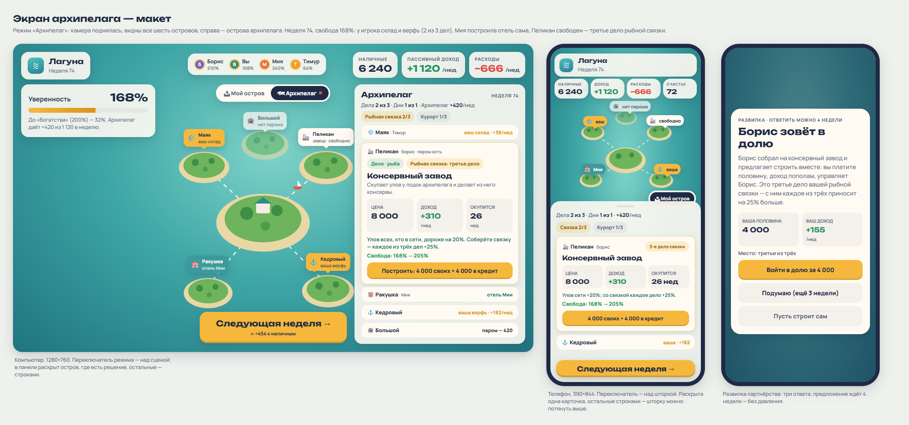

# Экран архипелага: карта, паромы, карточки дел

Ветка `claude/archipelago-spec`. Правила — [archipelago.md](archipelago.md), итерация 2 («три дела из пяти», наборы,
сосед ждёт ответа 4 недели, материк достраивает остальное). Владелец принял их 2026-10-17, риск отеля — нормально.
Макет: [archipelago-screen/mockup.html](archipelago-screen/mockup.html), снимок — ниже.

## Главное

- **Архипелаг — это режим, а не вкладка.** Кнопка-переключатель «Архипелаг ↔ Мой остров» уводит камеру вверх так, что
  видны все шесть островов, а правая панель (на телефоне — шторка) показывает острова архипелага. Вкладок не прибавляется:
  на телефоне пятая вкладка не помещается в 360 px.
- **Все решения — в панели, сцена их показывает.** Как сейчас со сделками: купить, провести паром, выбрать управляющего —
  кнопками в карточках. На сцене — паромы, метки над островами и лодка на линии; нажатие на метку открывает карточку острова.
- **Новых 3D-моделей нет.** Дела на соседних островах в первой версии — метки с иконкой над островом. Здания — отдельным
  шагом, когда архипелаг понравится игрокам (принцип 5).
- **Числа и тон — как у карточек сделок:** три ячейки, строка «Свобода: 160% → 185%», одна кнопка-действие.

## Путь игрока

| Когда | Что видит |
|---|---|
| до свободы | ничего нового |
| свобода, меньше 150% | в блоке «До финансовой свободы» строка «Архипелаг откроется при 150% — сейчас 112%»; переключатель режима виден, с замком и той же подсказкой |
| неделя, когда впервые 150% | окно «Архипелаг открыт» (текст ниже) → «Посмотреть архипелаг» включает режим; одна подсказка у первого парома |
| дальше | переключатель; на нём точка-значок, когда в архипелаге есть что решить (развилка, дело по карману, поломка) |
| финал «Архипелаг процветает» | эпилог с новой строкой «Наследие» (сколько соседей свободны, сколько заработали рядом с вами) |

## Режим «Архипелаг»

**Переключатель.** Компьютер — пилюля над сценой по центру, под строкой новостей: «🗺 Архипелаг» / «🏝 Мой остров».
Телефон — пилюля справа над ручкой шторки. Режим запоминается до перезагрузки; «Следующая неделя» работает в обоих режимах.

**Камера.** Плавный перелёт за 1,2 с (`CameraRig`): выше и дальше, чтобы родной остров был в центре, а пять островов
горизонта — по кругу; туман отодвигается, чтобы их было видно. Учитывает боковые колонки на компьютере и шторку на
телефоне (как сейчас `sideInsets`/`bottomInset`). Обратно — тем же перелётом. С `prefers-reduced-motion` — без полёта.

**Что на сцене:**
- **паромы** — пунктирная дуга по воде от родного острова к соединённому, по ней раз в несколько секунд плывёт лодочка;
- **метки над островами** (как плавающие надписи `FloatLabels`): иконка дела, имя острова, одно слово состояния;
  цвета — свободно (бумага), ваше (золото), соседа (бирюза), материка (серый), повреждено (красная точка);
- острова без парома чуть бледнее; нажатие на метку открывает карточку этого острова в панели.

**Без WebGL** (запасной вид уже есть): панель работает полностью, сверху в ней — простая схема из шести кружков с
линиями паромов и теми же иконками (SVG, 120 px высотой).

## Панель архипелага

**Шапка** — одна строка и плашки наборов:
- «Дела **2 из 3** · Дни **1 из 1** · Архипелаг **+420**/нед»;
- плашки «Рыбная связка 2/3» и «Курорт 1/3»; собранный набор — золотая плашка «+25% к каждому».

**Острова** — пять карточек в постоянном порядке, как на карте: Маяк, Пеликан, Ракушка, Кедровый, Большой. На телефоне
раскрыта одна карточка (выбранная или первая, где есть что решить), остальные — свёрнутые строки «Остров · дело · состояние».

| Состояние | Что в карточке | Кнопка |
|---|---|---|
| нет парома | имя острова, житель, «Здесь можно построить: склад-холодильник»; строка «Билеты ≈ +10/нед чистыми» | «Провести паром — 700» (с верфью — 420) |
| паром есть, дело свободно | плашки «Дело · рыба», «Набор: рыбная связка»; название; одно предложение; три ячейки **ЦЕНА · ДОХОД · ОКУПИТСЯ**; строка эффекта; «Свобода: 160% → 185%» | «Построить за 8 000»; не хватает, но выручает кредит — «Построить: 4 000 своих + 4 000 в кредит»; иначе неактивная «Не хватает 1 200» |
| паром есть, мест нет | то же, ячейки бледнее | неактивная «У вас уже 3 дела из 3» и подсказка «Место освободится, если продадите дело покупателю» |
| ваше дело | плашки «Ваше дело», набор; три ячейки **ДОХОД · СОДЕРЖ. · СТОИТ**; «Кто управляет» — три кнопки-варианта: «Сам · 1 день», «Тимур · 25%», «Наёмный · 20%» (недоступные — с причиной) | при поломке — «Починить за 1 500» (или «Застраховано — починят бесплатно») |
| в доле с соседом | «Вы и Мия — пополам, управляет Мия»; ячейки — ваша половина | — |
| дело соседа или материка | «Отель Мии» / «Склад компании с материка»; строка эффекта, если он действует на вас («Ваш улов +20%») | — |

Внизу панели — переключатель **«Страховка дел»** с премией в неделю (как страховка острова: действует через 4 недели).

**Числа.** В карточке — не больше трёх денежных чисел в ячейках и одна строка свободы. На экране телефона — четыре
показателя сверху (как сейчас), шапка архипелага (счётчики дел и дней) и одна раскрытая карточка.

## Развилки архипелага

Те же окна «Развилка», что и сейчас (`ChoiceModal`), три новых вида:

| Вид | Заголовок | Суть в окне | Кнопки |
|---|---|---|---|
| партнёрство | «Мия зовёт в долю» | «Мия собрала на отель и предлагает строить вместе: вы платите половину, доход пополам, управляет Мия». Ячейка «Ваша половина 5 000»; строка «Место: третье из трёх» | «Войти в долю за 5 000» · «Подумаю (ещё 3 недели)» · «Пусть строит сама». Не хватает денег — первая неактивна: «Не хватает 1 300», вторая остаётся |
| заём банка | «Приезжий просит 3 000» / «Тимур просит 2 000» | плашка надёжности (надёжный / обычный / рискованный), ставка и срок: «2,2% в неделю, 10 недель — +66/нед»; строка риска: «Обычные заёмщики не возвращают примерно каждый восьмой долг, в кризис — чаще»; если ходит надёжный слух о кризисе — он здесь же | «Дать 3 000» · «Отказать» |
| покупатель | «Компания с материка хочет купить верфь» | «Предлагает 7 000. Сейчас верфь приносит +205/нед — это 34 недели дохода. Место освободится» | «Продать за 7 000» · «Оставить» |

«Подумаю» закрывает окно; карточка острова и значок на переключателе напоминают о предложении, пока оно в силе.

## Тексты (RU, черновик координатора; EN — Antigravity)

**Окно «Архипелаг открыт»:** «Вы на 150% — «Уверенность». Соседние острова зовут вас по-крупному: проведите паром,
постройте завод, отель или банк. Дел может быть три из пяти — выбирайте, какие. Три дела одного набора приносят больше.»
Кнопка «Посмотреть архипелаг».

**Подсказка у первого парома:** «Паром связывает остров с вашим. Без парома дело на острове не построить.»

| Дело | Плашка | Одно предложение | Строка эффекта |
|---|---|---|---|
| Консервный завод (Пеликан) | Дело · рыба | Скупает улов у лодок архипелага и делает из него консервы. | Улов всех, кто в сети, дороже на 20%. Чем больше лодок в сети, тем больше доход завода. |
| Отель (Ракушка) | Дело · туризм | Самый большой доход, но гости едут по сезону, а кризис и шторм бьют сильнее всего. | Гостей больше с каждым обитаемым островом в сети. |
| Склад-холодильник (Маяк) | Дело · защита | Хранит улов, пока рыба дешёвая. Приносит мало, зато спасает в плохой год. | Когда рыба дешевеет, улов сети продаётся по обычной цене. С заводом — и завод не простаивает. |
| Верфь (Кедровый) | Дело · ремонт | Строит паромы и чинит лодки после штормов — зарабатывает, когда другим плохо. | Паромы на 40% дешевле. Доход за каждую линию и за ремонт после шторма. |
| Банк архипелага (Большой) | Дело · деньги | Приезжие и соседи просят в долг, а вы решаете, кому дать. | Процент — плата за риск: рискованный платит больше, но чаще не возвращает. |

**Наборы:** «Рыбная связка — завод, склад и верфь: если все три ваши, каждое приносит на 25% больше.»
«Курорт — отель, верфь и банк: паромы с верфи везут гостей, банк их обслуживает. Все три ваши — +25% к каждому.»

**Лимит:** «У вас уже 3 дела из 3. Остальные острова достроят соседи и компания с материка — их заводы и склады работают
и на вас.»

## Что нужно от движка (следующий шаг — Codex)

Прототип (`packages/engine/proto/archipelago`) переезжает в движок:
- `WorldState.archipelago` (состояние прототипа без своего ГПСЧ — случайность через `world.rng`), мир v9 и миграция:
  `archipelago: null`, а если сохранение уже на 150% и выше — открыть при загрузке;
- действия: `buildRoute`, `buyBusiness` (с полем `loan`), `setManager`, `repairBusiness`, `setArchInsurance`; развилки
  `partner`, `bankLoan`, `bizBuyer` — в общую систему `PendingChoice` (у партнёрства — срок ответа 4 недели);
- доход и расходы дел — настоящими строками отчёта недели и `financeView` (вместо псевдоактивов прототипа): «Дела
  архипелага», «Паромы», «Проценты банка», «Управляющие»;
- селектор `archipelagoView(world, playerId)`: шапка (дела/лимит, дни, доход архипелага, наборы), пять островов
  (состояние, житель, владелец, ячейки карточки, строка эффекта, `freedomAfter`, можно ли действовать и почему нельзя);
- боты (Мия, Борис) и материк — как в прототипе; цели `sim:arch` переезжают в `npm run sim`.

Аналитика GoatCounter: `arch-open`, `arch-mode`, `arch-route`, `arch-business-<дело>`, `arch-set-<набор>`, `arch-finale`.

## Приёмка

Playwright, 1366×768 и 390×844 (и 360×640 — без горизонтальной прокрутки):
1. после свободы — строка-обещание и замок на переключателе;
2. на 150% — окно «Архипелаг открыт», «Посмотреть» включает режим, камера улетает (флаг сцены), подсказка у первого парома;
3. паром → дело: деньги, «Дела 1 из 3», метка острова золотая, линия парома на сцене;
4. четвёртое дело — неактивная кнопка с текстом лимита;
5. набор 3/3 — золотая плашка, доход каждого дела +25% в карточке и в отчёте недели;
6. партнёрство: «Подумаю» закрывает окно, значок на переключателе остаётся 3 недели;
7. без WebGL — схема в панели, все действия работают;
8. в каждой карточке не больше трёх денежных чисел; на телефоне раскрыта одна карточка.

## Кто делает

| Часть | Исполнитель |
|---|---|
| контракт в коде (типы, `archipelagoView`-заглушка, ключи словаря), русские тексты, приёмка | Claude |
| движок: перенос прототипа, миграция v9, тесты, `npm run sim` | Codex 1 |
| интерфейс: переключатель, панель, карточки, окна, схема без WebGL | Codex 2 (после контракта, параллельно с Codex 1) |
| сцена: перелёт камеры, паромы, метки | Codex 3 (или вместе с интерфейсом) |
| английские тексты | Antigravity |

## Вопросы владельцу

1. Архипелаг — отдельный режим с переключателем, а не пятая вкладка. Так?
2. В первой версии над соседними островами — метки с иконками, а не 3D-здания. Здания — следующим шагом. Так?
3. На телефоне раскрыта одна карточка острова, остальные свёрнуты в строки. Удобно или показать все раскрытыми со скроллом?
